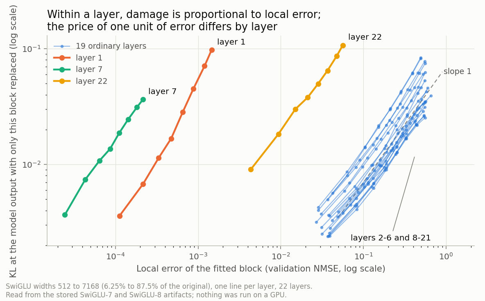
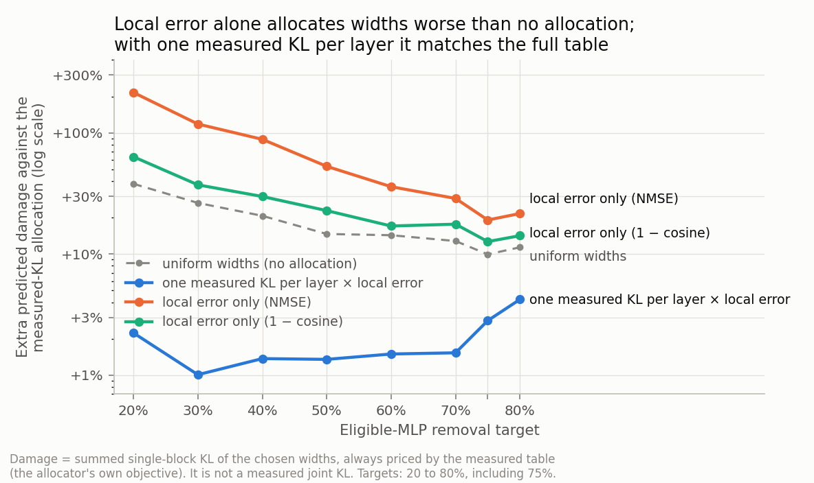

# 2. Is the local fit predictive? An answer from data you already have

Part of the [deep analysis, part 2](README.md). It covers the supervisor's
suggestion from the 2026-11-13 meeting (your topic 1.3) and the annotation's
premise that an MLP block can be treated "as an isolated function". Evidence
labels and flags are defined in the [README](README.md#labels-and-flags).

## Short answer

- **Your reading of the supervisor is right, and the question splits in two.**
  "Is the local fit predictive?" has one answer for choosing *within* a layer
  and the opposite answer for choosing *between* layers.
- **Within a layer: yes, almost perfectly.** Across every operator and size
  stored for a layer, local error ranks the options like measured KL does
  (rank correlation 0.995). At equal size it picks the same operator as KL in
  163 of 176 cases, and where it differs the cost is small (at most 8.8% KL).
- **Between layers: no.** Local error says nothing useful about which layer to
  compress. A width allocation priced by local error alone is predicted to be
  *worse than giving every layer the same width*.
- **One measurement per layer repairs it.** Damage is proportional to local
  error inside a layer, and the constant differs by layer. With one measured KL
  per layer to fix that constant, local error reproduces the allocator's
  176-entry price table to within 1-4%, from 22 measurements.
- **Your pushback is also right, and now has numbers.** An operator can win
  locally and lose globally: it happens in 13 of 176 cells, always at the
  smallest size, always plain MLP beating SwiGLU on local error and losing on
  KL.

All of this was read from stored artifacts with a script. Nothing was run on a
GPU, and "damage" here always means single-block KL before any retraining.

**Flags.** ROI: DECISIVE for the annotation's hypothesis, and cheap. Scope:
the proportionality is a TRANSFERABLE HYPOTHESIS (it follows from a standard
approximation); the three outlier layers and every number are MODEL-CONCRETE.

## 2.1 What the supervisor asked, as I read it

Three readings fit his words. They are one study, not three **[view]**:

| Reading | Question | Status after this session |
| --- | --- | --- |
| R1, filter | At one layer and one size, can local error choose the operator, so that KL is measured only for the winner? | Answered offline: yes, with small regret (2.3) |
| R2, allocator | Can local error replace KL as the price in the knapsack? | Answered offline at the level of predicted damage: no, unless each layer gets one measured KL (2.5) |
| R3, hypothesis | How well does local error predict global damage at all? | Answered offline for single blocks before retraining (2.2-2.4); open for joint damage and after retraining (2.8) |

Your point about mixture-of-experts models is the practical reason to care:
the knapsack itself stays cheap with thousands of experts, but measuring a KL
for every expert and every menu item does not ([file 3](03-moe.md)).

## 2.2 Within a layer, local error ranks options like KL does

Data **[ran: `private/tools/local_fit_vs_kl.py`]**: for each of the 22 eligible
layers, 25 fitted options with both a held-out local error and a measured
single-block KL: 9 SwiGLU widths, 8 plain MLP sizes, 7 linear + SwiGLU sizes,
and the linear map. The linear + plain MLP family is left out because its fits
stalled (2026-11-13 snapshot, section 2.1). Local error is the validation NMSE
your runners already store (squared error divided by the target's energy).

| Check | Result |
| --- | --- |
| Rank correlation of NMSE with KL across a layer's 25 options, median over layers | 0.995 (lowest layer 0.978) |
| The same, SwiGLU widths only | 1.000 in every layer |
| Slope of log KL on log NMSE across SwiGLU widths, per layer | median 1.00 (range 0.89 to 1.33), R² at least 0.985 |

- **A slope of 1 means proportionality:** halve the local error and the
  damage halves. Each layer is a straight line in the figure.
- **The lines are parallel but not on top of each other.** That offset is the
  whole problem with using local error between layers (2.4).

## 2.3 Choosing the operator at equal size

At each layer and each of 8 sizes, two or three operator types compete at the
same parameter count **[ran]**.

| Check | Result |
| --- | --- |
| Lowest NMSE is also lowest KL | 163 of 176 cells (92.6%) |
| KL lost by choosing on NMSE | mean 0.31%, largest 8.8% |
| Pairs of operators ordered the same way by both | 462 of 484 (95.5%); 175 of 197 (88.8%) when their KLs are within 25% |
| Plain MLP against linear + SwiGLU | same order in 145 of 154 |

- **All 13 disagreements are one pattern.** At the smallest size (6.25% of an
  MLP), in layers 2-4, 8-16, and 19, a plain MLP has the lower local error
  and SwiGLU the lower KL.
- **So as a filter, local error is safe here:** it never discards an operator
  that KL would have preferred by more than 9%.
- **A full menu priced this way would have picked hybrids.** With prices from
  one KL per layer times NMSE, the solver picks no non-SwiGLU block up to 60%
  removal, one at 70%, none at 75%, four at 80%, and ten at 90%, at a
  predicted cost of 1-5% over the measured-KL solution. That fits Heterogeneous-2, where the
  forced 80% model (all plain MLP) came out level.

A third check uses the recipe-selection fits (many recipes and three seeds for
the same block). There a better local fit also means a lower KL, *if both are
measured on the same kind of text*: in SwiGLU-8's six cells, 128-token NMSE
against 128-token KL correlates 0.69 to 0.97. Against 8K-context KL the same
NMSE correlates negatively at layers 3 and 11 (−0.07 to −0.57) and positively
at layer 19, because the recipes trained on 8K context fit the 128-token
validation set worse and the long-context evaluation better.
**Local error predicts damage only on the distribution it was measured on.**

## 2.4 Between layers, local error is not comparable

Take one option, for example SwiGLU at half width, and ask which layers it
hurts most **[ran]**.

| Signal, across the 22 layers | Rank correlation with measured KL |
| --- | ---: |
| NMSE | −0.14 to −0.31 |
| Plain MSE | +0.22 to +0.35 |
| 1 − cosine | −0.20 to −0.42 |
| Zero-ablation KL × NMSE | +0.36 to +0.48 |

The "price of one unit of error" (KL divided by NMSE at half width) explains
why:

| Layers | KL per unit of NMSE | Mean squared size of the MLP's output |
| --- | ---: | ---: |
| 2-6, 8-21 (19 layers) | 0.048 to 0.142 (3 times) | 0.24 to 44, rising with depth |
| 22 | 1.79 | 527 |
| 1 | 35.4 | 46 (neighbours: 0.24) |
| 7 | 158 | 2,621 (neighbours: 0.75 and 1.3) |

- **Three layers write outputs hundreds of times larger than their
  neighbours.** NMSE divides by that size, so their local error looks
  negligible (0.0002 at layer 7) while their damage is ordinary. An allocator
  that trusts NMSE narrows exactly these layers to 6-12% width.
- **Hypothesis, not a result:** these are "massive activations", a few fixed,
  very large values on the first token that act as biases. The published
  description is that they appear at an early layer and persist until late
  layers **[lit: Sun et al. 2024, arXiv 2402.17762, sections 2-3; read by a
  research agent, not by me]**. Here the MLPs of layers 1 and 7 would write
  them and layer 22 would remove them. It would also explain two older
  observations: the monitoring perplexity that mostly measures position 1
  (2026-10-25 audit), and the pairs of layers that collapse the model together,
  (1, 22), (5, 22), (7, 22), in [Part 1, file 3](../2026-11-12-deep-analysis/03-future-work.md).
  A direct check is small: the per-position size of the MLP output at layers
  1, 7, and 22.
- **Even among the 19 ordinary layers the price varies three-fold,** and late
  layers cost more per unit of error than middle ones.

## 2.5 What that does to an allocation

I re-ran your knapsack with other prices and scored each resulting allocation
with the measured table **[ran; the repository's own solver, loaded from
`allocation.py`]**. The number is the extra predicted damage against the
measured-KL allocation.

| Prices used by the knapsack | KL measurements | 20% | 50% | 80% |
| --- | ---: | ---: | ---: | ---: |
| Measured KL (today) | 176 | 0 | 0 | 0 |
| One measured KL per layer × NMSE | 22 | +2.2% | +1.4% | +4.2% |
| One measured KL per layer × (1 − cosine) | 22 | +3.9% | +1.1% | +2.9% |
| Uniform widths, no knapsack | 0 | +38% | +15% | +11% |
| 1 − cosine only | 0 | +64% | +23% | +14% |
| Zero-ablation KL × NMSE | 22 | +78% | +47% | +18% |
| NMSE only | 0 | +215% | +53% | +22% |
| MSE only | 0 | +160% | +61% | +17% |
| Slice-only NMSE (no fit at all) | 0 | +213% | +54% | +21% |

- **Purely local prices lose to uniform widths at every target.** This is the
  clean negative answer to "local fit instead of the knapsack".
- **One measured KL per layer is enough.** The table uses a probe at half
  width. A probe at quarter width also prices other operator types in that
  layer: plain MLP within 7% (median) and linear + SwiGLU within 5%, with
  pooled rank correlation 0.98-0.99 against 0.09-0.61 without the probe. The linear map is the exception (median 23%, some layers
  far off).
- **The uniform row matches Part 1.** Part 1 wrote the same gap the other way
  round (knapsack 9-27% below uniform).

## 2.6 Why this is expected

For a small change, the KL between two output distributions is a quadratic
form in the change. This is a standard approximation and should be cited when
used, for example Martens (JMLR 2020), "New Insights and Perspectives on the
Natural Gradient Method", sections 6 and 9.1 **[lit: located by a research
agent; check the equations in the PDF]**. Applied to one block, with
$\delta_t$ the substitute's output error on token $t$:

$$
\mathrm{KL} \;\approx\; \tfrac{1}{2}\,\mathbb{E}_t\!\left[\delta_t^{\top} F_{\ell,t}\,\delta_t\right],
\qquad F_{\ell,t} = J_{\ell,t}^{\top} F^{\text{out}}_t J_{\ell,t}
$$

Here $J_{\ell,t}$ maps a change at layer $\ell$'s MLP output to the logits and
$F^{\text{out}}_t$ is the Fisher matrix of the output distribution. Writing it
for an activation instead of for weights is my composition of the two cited
sections, so it is an **explanatory formalization**, not a quoted equation.

- If $F_{\ell,t}$ treats all directions alike, KL is the mean squared error
  times a layer constant. That is the slope of 1 and the per-layer offset.
- Local MSE silently assumes that constant is the same in every layer. It is
  not.
- The measured constant is the same idea as the per-layer sensitivity
  coefficients that earlier allocators fit against model loss (SPDY, ZipLM)
  and as DONNA's fitted predictor, which ranked architectures better than a
  plain sum of block errors **[lit: agent-read; SPDY section 3.3-3.4, DONNA
  section 3.2.2]**. So the *idea* is prior work. What I did not find
  anywhere, and the literature agent did not either, is a measurement of how
  local fit error relates to model KL for trained block substitutes.
- Published counter-examples to "lower local error is better" exist where
  candidates err in different directions or overfit the calibration data
  **[lit: agent-read; FWSVD Fig. 6, Braun et al. 2405.12241, Shin et al.
  2406.15524]**. Your 13 cells are a mild case of the first kind.

## 2.7 What this does not show

| Limit | Consequence |
| --- | --- |
| Single blocks only | Joint damage is 23-55% above the sum (your note). Whether local-priced allocations are worse in *real* joint KL is unmeasured |
| Before retraining only | Selection signals often stop mattering after fine-tuning **[lit: agent-read; CLADO section 5.2, Liu et al. 2019]**; your own fit-versus-slice result is the same pattern |
| The 128-token selection partition | Section 2.3's third check says the answer depends on the text it is measured on |
| The probe and the truth come from one table | 22 of 176 values predict the other 154, so it is a real prediction, but on one model |
| One model, one seed | Layers 1, 7, 22 and every number are specific to SmolLM2-1.7B |

## 2.8 A study design that finishes the question

A proposal for discussion, not a plan. Rough costs from throughput in your
docs; not a PERUN resource plan.

| Step | What | Cost | Answers |
| --- | --- | --- | --- |
| 0 | Offline analysis (this file); add it to a notebook | none | R1, R3 before retraining |
| 1 | Assemble about 15 allocations (measured-KL, probe × NMSE, 1 − cosine, NMSE, uniform at 20/50/80%) and measure their real joint KL at token 0 | evaluation only, about 2-3 GPU-h; new fits only for off-grid widths | Does the predicted ordering hold jointly? This is also Part 1's "ranking test" |
| 2 | Retrain four of them at 50% (and 80% if wanted) for 100M tokens | 4-8 runs, about 6-12 GPU-h | Does the selection signal survive retraining? This is also Part 1's knapsack-against-uniform check |
| 3 | A gradient-weighted local error: one backward pass gives each layer's constant without any probe | new code, a few GPU-h | Whether "local" can be made comparable between layers with no model-level measurement. This is what a mixture-of-experts model needs |
| 4 | The per-position check of layers 1, 7, 22 | minutes | The massive-activation hypothesis |

Steps 0-2 answer the annotation's hypothesis in full and cost less than one 1B
run. Step 3 is the bridge to [file 3](03-moe.md).

**A sentence the thesis could then carry** (wording yours): *local fit quality
predicts a substitute's damage within a block, but blocks differ in how much
one unit of local error costs, so local fitting can choose the substitute and
cannot choose where to compress.*
