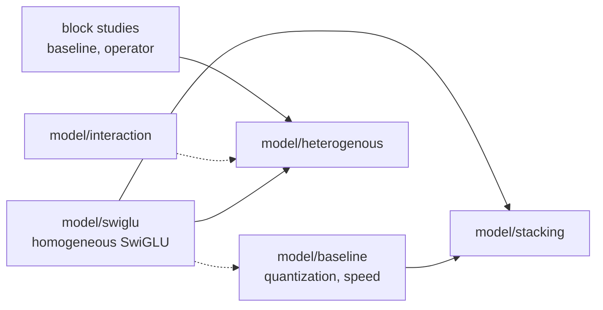
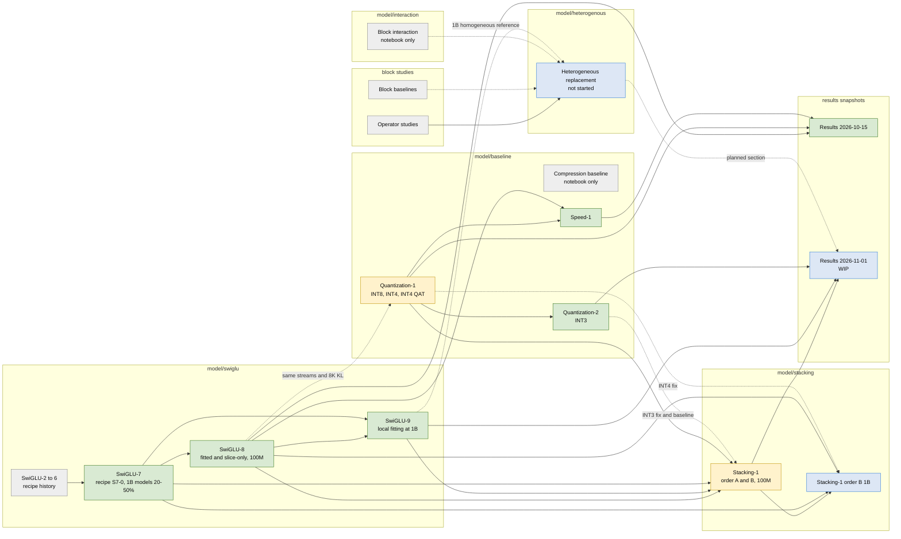

# Experiment dependencies and status

Which experiment uses whose models, data, or code, and what is running now.
Status is as of the `modified` date. Update this page at phase boundaries (plan,
deploy, results), together with the experiment page. An arrow means "uses models,
data, or code from"; a dotted arrow means the dependency is only a comparison or
a shared measurement.

## Classes

## Experiments

Green: done. Yellow: reruns in progress. Blue: planned or work in progress.
Grey: historical or notebook-only.

| Experiment | Status (2026-11-01) | Depends on |
| --- | --- | --- |
| [SwiGLU-2 to 6](model/swiglu/swiglu-progression.md) | Historical recipe progression | - |
| [SwiGLU-7](model/swiglu/swiglu-7.md) | Done; its S7-0 recipe and 1B 20/50% models are reused | SwiGLU-6 |
| [SwiGLU-8](model/swiglu/swiglu-8.md) | Done; token-0 starts and 100M models are reused | SwiGLU-7 |
| [SwiGLU-9](model/swiglu/swiglu-9.md) | Done; local fitting closed at 1B | SwiGLU-7 (1B stream, 20/50% models), SwiGLU-8 (starts) |
| [Quantization-1](model/baseline/quantization-1.md) | Done; INT4 QAT 100M rerun as `-002` after the INT4 fix | SwiGLU-7/8 streams and 8K KL (shared) |
| [Quantization-2](model/baseline/quantization-2.md) | Done; INT3 QAT valid from `-002` | Quantization-1 runner and preparation |
| [Speed-1](model/baseline/speed-1.md) | Done | Quantization-1, SwiGLU-8 models |
| [Compression baseline](model/baseline/compression-baseline.md) | Notebook artifacts only | - |
| [Stacking-1](model/stacking/stacking-1.md) | Ran 48/48; order-B INT3 rerun as `-002`; order-B INT4 rerun pending | SwiGLU-7/8/9 models, Quantization-1 backend, Quantization-2 INT3 fix |
| Stacking-1 order B 1B | Planned (6 runs) | Order-B `-002` runs at 100M (INT3, INT4), SwiGLU-7 1B stream, SwiGLU-8 starts |
| [Block interaction](model/interaction/block-interaction.md) | Notebook artifact only | - |
| [Heterogeneous replacement](model/heterogenous/README.md) | Not started; block-level study per operator first | Block studies, SwiGLU-9 1B reference |
| [Results 2026-11-01](../results/2026-11-01-results.md) | WIP for the 2026-11-06 meeting | SwiGLU-9, Stacking-1, Quantization-2; heterogeneous later |

Invalid and excluded runs (decision log, 2026-10-25): Quantization-2
`qat-int3-{100m,1b}-001` and Stacking-1 `b-fitted-*-100m-int3-001`.

## Active and planned runs

| Run | Experiment | Depends on | Owner | Job | Status |
| --- | --- | --- | --- | --- | --- |
| `qat-int4-100m-002` | Quantization-1 | INT4 fix, commit `b59da5c` | INT4-audit session | 140530 | Running; start check 66/66 equal |
| `b-fitted-{0.2,0.5,0.8}-100m-int4-002` | Stacking-1 | INT4 fix, commit `b59da5c` | INT4-audit session | - | To submit (runbook 10.6) |
| `qat-int4-1b-002` | Quantization-1 | `qat-int4-100m-002` result | Researcher decision | - | Undecided |
| `b-fitted-{0.2,0.5,0.8}-1b-int{3,4}` | Stacking-1 order B 1B | Order-B INT4 `-002` (finished, for the INT4 twins), order-B INT3 `-002` (done) | Order-B-1B session | - | Planned |
| TorchAO INT3 upstream check | Quantization-2 | - | TorchAO session | - | Investigation, no GPU |
| Results-2 snapshot | Results | The runs above; heterogeneous | Results session | - | WIP |
