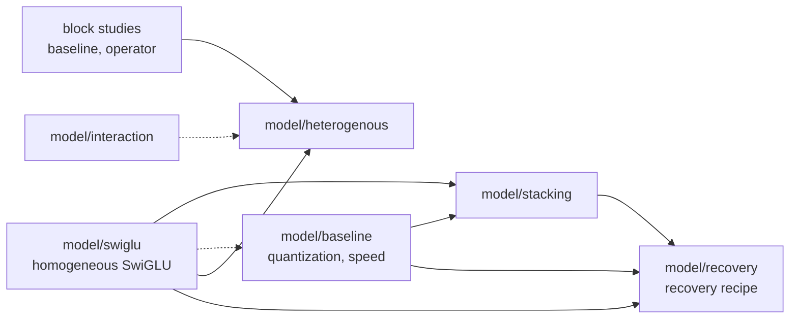
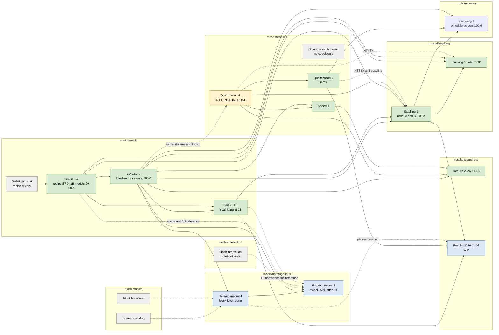

# Experiment dependencies and status

Which experiment uses whose models, data, or code, and what is running now.
Status is as of the `modified` date. Update this page at phase boundaries (plan,
deploy, results), together with the experiment page. An arrow means "uses models,
data, or code from"; a dotted arrow means the dependency is only a comparison or
a shared measurement.

## Classes

## Experiments

Green: done. Yellow: reruns in progress. Blue: planned or work in progress.
Grey: historical or notebook-only.

| Experiment | Status (2026-11-01) | Depends on |
| --- | --- | --- |
| [SwiGLU-2 to 6](model/swiglu/swiglu-progression.md) | Historical recipe progression | - |
| [SwiGLU-7](model/swiglu/swiglu-7.md) | Done; its S7-0 recipe and 1B 20/50% models are reused | SwiGLU-6 |
| [SwiGLU-8](model/swiglu/swiglu-8.md) | Done; token-0 starts and 100M models are reused | SwiGLU-7 |
| [SwiGLU-9](model/swiglu/swiglu-9.md) | Done; local fitting closed at 1B | SwiGLU-7 (1B stream, 20/50% models), SwiGLU-8 (starts) |
| [Quantization-1](model/baseline/quantization-1.md) | Done; INT4 QAT 100M rerun as `-002` after the INT4 fix | SwiGLU-7/8 streams and 8K KL (shared) |
| [Quantization-2](model/baseline/quantization-2.md) | Done; INT3 QAT valid from `-002`; `qat-int3-1b-002` completed 2026-11-04 | Quantization-1 runner and preparation |
| [Speed-1](model/baseline/speed-1.md) | Done | Quantization-1, SwiGLU-8 models |
| [Compression baseline](model/baseline/compression-baseline.md) | Notebook artifacts only | - |
| [Stacking-1](model/stacking/stacking-1.md) | Ran 48/48; order-B INT3 and INT4 rerun as `-002` (INT4 completed 2026-11-01) | SwiGLU-7/8/9 models, Quantization-1 backend, Quantization-2 INT3 fix |
| [Stacking-1 order B 1B](model/stacking/stacking-1.md#order-b-at-1b-results-2026-11-02) | Done 2026-11-02: 6/6 completed; order B beats order A at 1B by 24-52% in 8K KL | Order-B `-002` runs at 100M (INT3, INT4), SwiGLU-7 1B stream, SwiGLU-8 starts |
| [Block interaction](model/interaction/block-interaction.md) | Notebook artifact only | - |
| [Heterogeneous-1](model/heterogenous/heterogeneous-1.md) | Done 2026-11-06: 59/59 completed; no new operator picked, no ranking swap | SwiGLU-8 (Part A protocol, streams, cost tables); block operator studies as background |
| [Heterogeneous-2](model/heterogenous/heterogeneous-2.md) | Step 1 implemented 2026-11-06, not yet run; Steps 2 and 3 conditional | Heterogeneous-1, SwiGLU-8 (100M pairs), SwiGLU-7 and SwiGLU-9 (1B references) |
| [Recovery-1](model/recovery/recovery-1.md) | Designed and implemented 2026-11-07, not run; decides each family's schedule before any 3B run | Quantization-2, Stacking-1, and SwiGLU-8 recorded runs and starts; SwiGLU-8 selection stream; 1B constant runs for the token-equivalent |
| [Results 2026-11-01](../results/2026-11-01-results.md) | WIP for the 2026-11-06 meeting | SwiGLU-9, Stacking-1, Quantization-2; heterogeneous later |

Invalid and excluded runs (decision log, 2026-10-25): Quantization-2
`qat-int3-{100m,1b}-001` and Stacking-1 `b-fitted-*-100m-int3-001`.

## Heterogeneous experiments

The order of work inside each experiment is on its page.

| Experiment | Question | Operators | Status | Depends on | Reused by |
| --- | --- | --- | --- | --- | --- |
| Heterogeneous-1 | How should each operator be fitted, which get picked, can pre-recovery prices be trusted? | Zero, mean, linear, plain MLP, linear + SwiGLU, linear + plain MLP | Done 2026-11-06: 59/59 completed; no new operator picked, no ranking swap | SwiGLU-8 | Heterogeneous-2, results snapshot |
| Heterogeneous-2 | Do new blocks catch up after real training, when forced into the model? | Forced: linear + SwiGLU, plain MLP | Step 1 implemented 2026-11-06, not yet run | Heterogeneous-1, SwiGLU-7/8/9 | Results snapshot |

## Active and planned runs

| Run | Experiment | Depends on | Owner | Job | Status |
| --- | --- | --- | --- | --- | --- |
| `qat-int4-100m-002` | Quantization-1 | INT4 fix, commit `b59da5c` | INT4-audit session | 140530 | Completed; deployed 8K KL 0.0291, no conversion gap |
| `b-fitted-{0.2,0.5,0.8}-100m-int4-002` | Stacking-1 | INT4 fix, commit `b59da5c` | INT4-audit session | 140575 (array 0, 2, 4) | Completed; KL 0.102 / 0.249 / 0.564 (`-001`: 0.102 / 0.255 / 0.579) |
| `qat-int4-1b-002` | Quantization-1 | `qat-int4-100m-002` result (gap removed) | INT4-audit session | 140605 | Completed; KL 0.0297 (100M: 0.0291), macro 67.06% (100M: 65.87%) |
| `b-fitted-{0.2,0.5,0.8}-1b-int{3,4}` | Stacking-1 order B 1B | Order-B INT3 `-002` (in-run twins), order-B INT4 `-002` (compared afterwards) | Order-B-1B session | 140758 (array 0-5) | Completed 2026-11-02; 8K KL INT4 0.077 / 0.173 / 0.395, INT3 0.128 / 0.215 / 0.435 |
| `qat-int3-1b-002` | Quantization-2 | SwiGLU-7 1B stream, Quantization-1 `prepare-001`, `qat-int3-100m-002` (twin rows) | INT3-1B session | 142928 | Completed 2026-11-04; 8K KL 0.0709 (100M: 0.0804), macro 64.78%; on all three frontiers near 51% |
| `select-001`, `baseline-table-001` | Heterogeneous-1 | SwiGLU-8 `prepare-001` and `block-check-001` | Heterogeneous-1 session | 143434, 143435 | Completed 2026-11-04; recipes pinned in `cff64fd` |
| `cost-table-001`, `recovery-001`, `solve-001`, `assemble-001`, `summary-001` | Heterogeneous-1 | Pinned recipes, `select-001`, `baseline-table-001` | Heterogeneous-1 session | 144574, 144575, 144734, 145235 | Completed 2026-11-06; no hybrid target, no swap, forced runs required |
| `swiglu-0.8-control`, then `forced-{0.2,0.5,0.8}`, `forced-0.8-lr1e-4`, `swiglu-0.8-lr1e-4` | Heterogeneous-2 Step 1 | Heterogeneous-1 `assemble-001`, cost tables; SwiGLU-8 `prepare-001`, fitted runs | Heterogeneous-2 session | - | Implemented, not submitted |
| `dense-int3`, `b-0.2-int4`, `swiglu-0.2` (`-run-001`) | Recovery-1 | Recorded constant runs (Quantization-2, Stacking-1, SwiGLU-8), SwiGLU-8 `prepare-001` and selection stream | Recovery-1 session 2b | - | Implemented, not submitted; deploy after Heterogeneous-2 Step 1 has left the queue |
| TorchAO INT3 upstream check | Quantization-2 | - | TorchAO session | - | Investigation, no GPU |
| Results-2 snapshot | Results | The runs above; heterogeneous | Results session | - | WIP |
