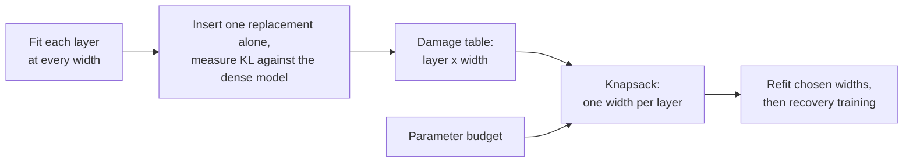
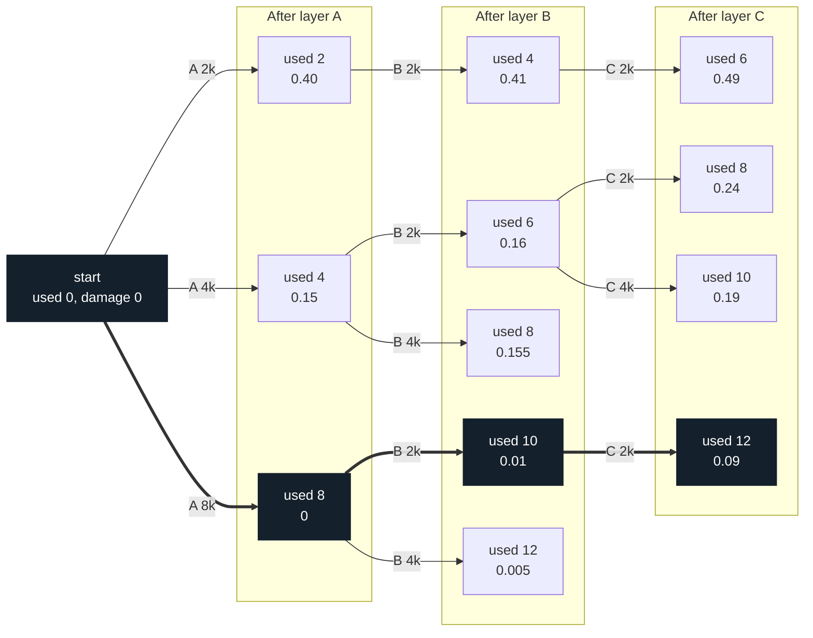

# Knapsack width allocation, explained

This page explains how the project chooses one SwiGLU width for each layer. It
is the intuitive companion to the
[width-allocation note](../methodology/width-allocation-integer-program.md),
which holds the full formulation, proofs, and evidence.

**In one sentence.** We measure how much each layer suffers at each width, then
choose the combination with the lowest predicted total damage that fits the
parameter budget.

## 1. The problem

We must shrink 22 MLP layers to fit one shared parameter budget. Layers are not
equally sensitive, so cutting them all equally wastes budget on layers that
would barely notice.



## 2. A small example

The numbers in this section are invented. Three layers each take one width, and
the widths may total at most 12k.

| Layer | Damage at 2k | Damage at 4k | Damage at 8k (dense) |
| --- | ---: | ---: | ---: |
| A (sensitive) | 0.40 | 0.15 | 0 |
| B (tolerant) | 0.01 | 0.005 | 0 |
| C (in between) | 0.08 | 0.03 | 0 |

| Choice | Widths (A, B, C) | Total width | Total damage |
| --- | --- | ---: | ---: |
| Equal widths | 4k, 4k, 4k | 12k | 0.185 |
| Best choice | 8k, 2k, 2k | 12k | **0.09** |

At the same size, the best choice has about half the damage. It protects the
sensitive layer and pays for that with the tolerant one.

```text
Equal widths        A ####      B ####  C ####     damage 0.185
Best choice         A ########  B ##    C ##       damage 0.09
                    (one # = 1k of width)
```

## 3. From the example to the equation

**The analogy.** Packing a bag with a weight limit, where you must take exactly
one item from each group:

| Knapsack | Our problem |
| --- | --- |
| Group of items | A layer |
| Item in a group | A width for that layer |
| Item's weight | Parameters at that width |
| Bag's weight limit | Parameter budget |
| What you minimize | Total damage |

**The switch.** Let $x_{ik}=1$ mean "layer $i$ gets width $k$", and $0$
otherwise. Every choice of widths is a pattern of these switches.

**The equation.** *Standard multiple-choice knapsack, written as an integer
linear program. It needs a textbook citation, not yet registered; see the
[note](../methodology/width-allocation-integer-program.md#3-the-multiple-choice-knapsack-as-an-integer-linear-program).*

$$
\begin{aligned}
\min_{x}\quad & \sum_{i}\sum_{k} c_i(k)\,x_{ik} && \text{total damage} \\
\text{s.t.}\quad & \sum_{k} x_{ik} = 1 \quad \forall i && \text{one width per layer} \\
& \sum_{i}\sum_{k} p_i(k)\,x_{ik} \le B && \text{fits the budget} \\
& x_{ik}\in\{0,1\} && \text{each width is chosen or not}
\end{aligned}
$$

| Symbol | Meaning | Value here |
| --- | --- | --- |
| $i$ | An eligible layer | Layers 1-22 |
| $k$ | A width option | 9 options: 512, 1,024, 2,048 to 7,168 in steps of 1,024, and dense 8,192 |
| $c_i(k)$ | Damage: KL when only this layer is replaced | Measured |
| $p_i(k)$ | Parameters of a SwiGLU of width $k$ | $3dk$, with hidden size $d=2{,}048$ |
| $B$ | Parameters we may keep | Set by the removal target |

The sums look large, but the switches keep only one term per layer. In the
example, the best choice sets $x_{A,8k}=x_{B,2k}=x_{C,2k}=1$, so:

$$
\text{damage} = 0 + 0.01 + 0.08 = 0.09,
\qquad
\text{width} = 8k + 2k + 2k = 12k \le 12k.
$$

"Integer" means the switches are only 0 or 1. "Linear" means the damage and the
budget are plain weighted sums of them.

## 4. Why not try everything?

The example has $3^3=27$ combinations. The real problem has 9 options for each
of 22 layers:

$$
9^{22} \approx 10^{21} \text{ combinations.}
$$

## 5. The solver: keep only the best way to reach each budget

The problem is an integer linear program, but the code uses no ILP solver. It
solves the problem exactly with a dynamic program, which fills a table one
layer at a time.

**The idea.** After each layer, ask: for each amount of budget used so far, what
is the lowest damage that reaches it? If two partial choices use the same
budget, drop the worse one.

**The equation.** *Standard dynamic program. It needs the same textbook citation;
SPDY uses this recurrence over discretized time [`src-spdy-2022`, Section 3.2,
Eqs. (2)-(3)].*

$$
F_j(u)=\min_{k}\Big[\,F_{j-1}\big(u-w_j(k)\big)+c_j(k)\,\Big],
\qquad F_0(0)=0
$$

Read it as: the best way to use $u$ units on the first $j$ layers is the best way
to reach the remainder on the first $j-1$ layers, plus this layer's damage,
taking the best width $k$. Here $w_j(k)$ is the width's cost in budget units.
The answer is the smallest $F_n(u)$ with $u$ within the budget.

### The example, step by step

Each box shows the budget used and the lowest damage reaching it. Only surviving
states appear. The thick path is the winner.



The whole method is in what gets dropped. After layer B, three budgets can be
reached in two ways:

| Used | First way | Second way | Kept |
| ---: | --- | --- | --- |
| 6 | A 2k + B 4k: 0.405 | A 4k + B 2k: 0.16 | A 4k + B 2k |
| 10 | A 2k + B 8k: 0.40 | A 8k + B 2k: 0.01 | A 8k + B 2k |
| 12 | A 4k + B 8k: 0.15 | A 8k + B 4k: 0.005 | A 8k + B 4k |

Anything above 12 is thrown out as over budget. After layer C, the lowest damage
in the table is 0.09, at used 12, and following the path back gives A 8k, B 2k,
C 2k.

**Why dropping is safe.** Take two partial choices that use the same budget. The
remaining layers have the same budget left in both cases, and they add the same
damage to both. So the worse one can never catch up. This holds only because
total damage is a plain sum.

### Where it is in the code

The dynamic program is in `allocate_discrete_swiglu_widths`, in
[allocation.py](../../src/mlp_replacement/compression/allocation.py#L202-L230).

| Idea | Equation | Code |
| --- | --- | --- |
| The table | $F_j(u)$ | `states`: budget used → (damage, choices) |
| Start | $F_0(0)=0$ | `states = {0: (0.0, ())}` |
| Next layer | $j-1 \to j$ | `for layer in sorted(by_layer)` |
| Try a width | $F_{j-1}(u-w_j(k))+c_j(k)$ | `cost + point.monotone_teacher_kl` |
| Over budget | $u \le U$ | `if total > budget_units: continue` |
| Keep the best | $\min_k$ | The comparison with `existing` |

### How much work it saves

At 50% removal on the real curves, the table never holds more than 165 entries,
and the solver checks 22,770 candidates in total, against about $10^{21}$
combinations. Parameters are counted in units of $d$, and every width costs a
whole number of units, so nothing is rounded. (Offline calculation, 2026-11-06,
on `swiglu-8/prepare-001`.)

## 6. The real result

Damage from `swiglu-8/prepare-001`, at the same width in three layers:

| Layer | KL at 512 | KL at 2,048 | KL at 4,096 | KL at 6,144 |
| ---: | ---: | ---: | ---: | ---: |
| 12 (among the most tolerant) | 0.0254 | 0.0168 | 0.0090 | 0.0041 |
| 1 | 0.0972 | 0.0449 | 0.0168 | 0.0068 |
| 22 (most sensitive at all four) | 0.1068 | 0.0646 | 0.0379 | 0.0183 |

So the solver squeezes the tolerant middle layers and protects the ends. Widths
it chose, with bars for the 50% model (one `#` = 512 neurons):

```text
layer   20%    50%    80%   50% model
  1    8192   5120   4096   ##########
  2    8192   4096   2048   ########
  3    6144   4096   2048   ########
  4    8192   3072   2048   ######
  5    5120   3072    512   ######
  6    8192   3072    512   ######
  7    8192   3072    512   ######
  8    5120   4096   1024   ########
  9    4915   3072    512   ######
 10    5120   3072    512   ######
 11    4096   2048    512   ####
 12    4096   2048    512   ####
 13    4096   2048    512   ####
 14    4096   2048   1024   ####
 15    5120   3072   1024   ######
 16    6144   3072   1024   ######
 17    8192   5120   2048   ##########
 18    8192   6144   3072   ############
 19    8192   6144   3072   ############
 20    8192   6144   3072   ############
 21    8192   8192   2252   ################
 22    8192   8192   4096   ################
```

Against equal widths at the same budget, on predicted damage (the summed
single-layer KL, not a measured model):

| Removal | Equal width | Equal-width prediction | Knapsack prediction | Lower by |
| ---: | ---: | ---: | ---: | ---: |
| 50% | 4,096 | 0.3378 | 0.2949 | 13% |
| 75% | 2,048 | 0.6482 | 0.5896 | 9% |

The 50% model keeps SwiGLU-7's allocation. Re-solving with the wider grid gives
0.2946, a 0.1% difference. Widths such as 4,915 and 2,252 come from a small
leftover-budget step after the solve, which is a heuristic outside the exact
solve.

## 7. What "exact" does and does not mean

The solver finds the true optimum **of the predicted damage**. The prediction
adds up layers measured one at a time. *This is a project modelling choice, not
a theorem:*

$$
\mathrm{KL}\big(\text{all replacements together}\big)
\;\approx\;
\sum_{i} c_i(k_i)
$$

Real damage is larger than the sum, and the gap grows with removal:

| Removal | Predicted sum | Real KL before recovery | Real / predicted |
| ---: | ---: | ---: | ---: |
| 20% | 0.0901 | 0.1106 | 1.23 |
| 50% | 0.2949 | 0.3969 | 1.35 |
| 80% | 0.6770 | 1.0515 | 1.55 |

This does not by itself make the allocation wrong. The solver only needs to rank
allocations at one budget correctly, and a constant factor would not change the
winner. Whether the ranking holds has not been tested.

**Open points:**

- The ranking test has not been run
  ([proposal](../methodology/width-allocation-integer-program.md#53-what-has-been-measured-about-additivity)).
- The knapsack was never compared directly with equal widths under one recipe.
  It beat a ranked rule in SwiGLU-5, and that rule beat equal widths in SwiGLU-2,
  under different recipes.
- There is one model and one seed per allocation.

## 8. Where it comes from

The algorithm is not a project contribution. The multiple-choice knapsack and its
dynamic program are textbook material. Prior compression work also uses them:

- **SPDY** [`src-spdy-2022`] solves the same kind of per-layer choice exactly with
  a dynamic program, under a runtime budget.
- **ZipLM** [`src-ziplm-2023`] applies this kind of search to structured FFN
  width.
- **Puzzle** (Bercovich et al., [arXiv 2411.19146](https://arxiv.org/abs/2411.19146),
  not yet registered) is the closest match found to the whole pipeline: it trains
  block variants locally, scores each one inserted alone, sums the scores, picks
  one variant per layer with a mixed-integer program, then distills globally. It
  budgets memory, throughput, and latency rather than parameters.

The project's position against this prior work is under review on 2026-11-06.
