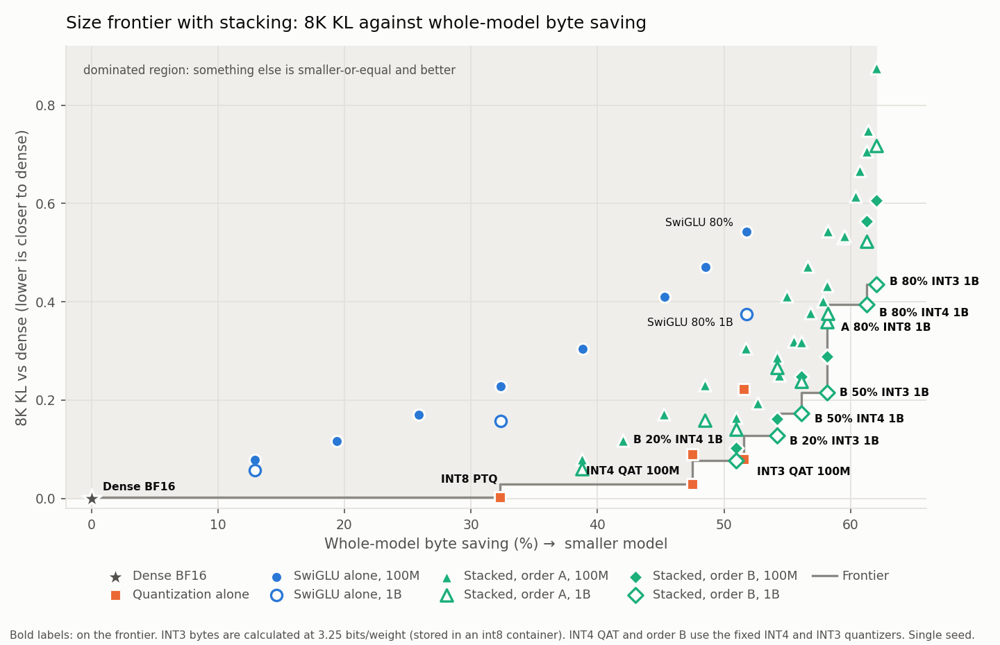
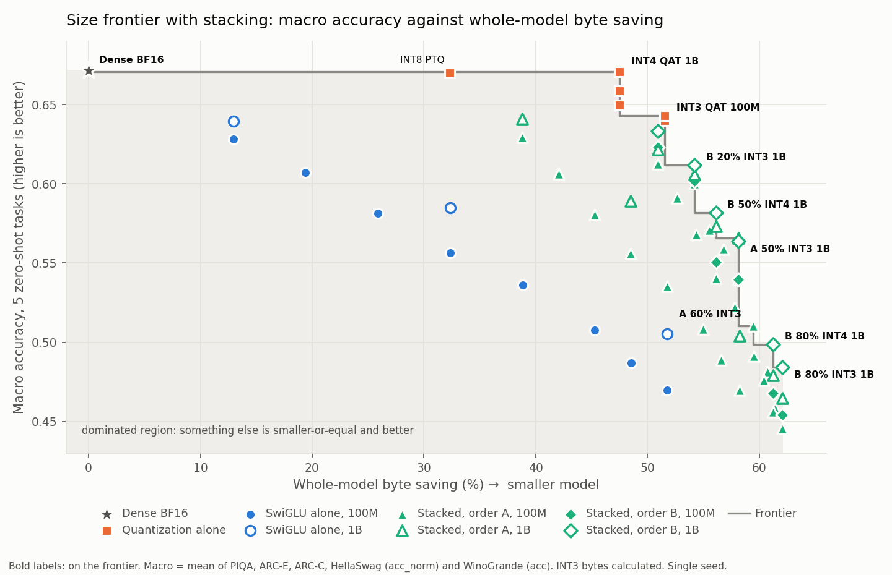
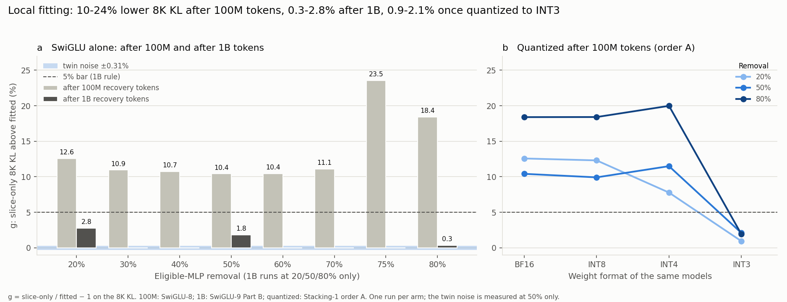
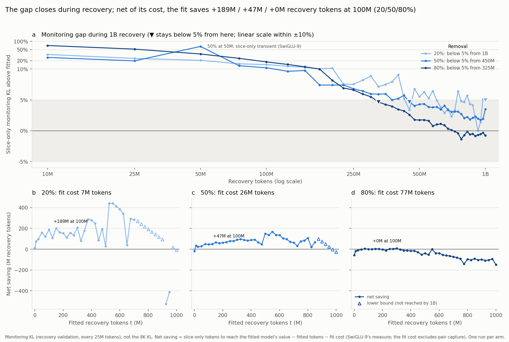
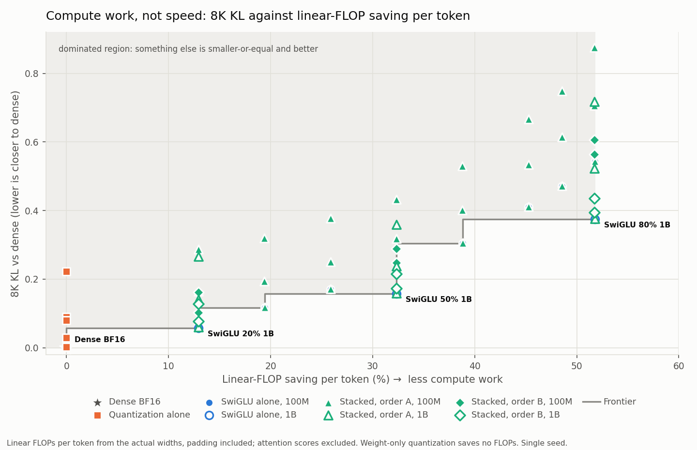

# Thesis results, snapshot 2026-11-01

**Work in progress:** section 4 is pending.

This snapshot follows the one of [2026-10-15](2026-10-15-results.md). It adds
stacking (SwiGLU replacement followed by MLP weight quantization), dense INT3,
and local fitting after 1B recovery tokens. The model is pinned
SmolLM2-1.7B, with the MLPs of layers 1-22 changed, scored on the
[core-eval](../methodology/core-eval.md) metrics, single seed. Every value
comes from the artifacts via the
[presentation notebook](../../notebooks/presentations/results-2026-11-01.ipynb).

## Headline

| Question | Answer so far |
| --- | --- |
| Who keeps more quality at equal bytes? | Quantization alone, up to 51.6%; on KL one stacked model joins it (B 20% INT4 1B) |
| Does stacking add anything? | Yes, beyond 51.6%: it extends the frontier to 62.1% saving |
| Quantize after recovery (A) or during it (B)? | B: 20-44% lower 8K KL at 100M, 24-52% at 1B |
| Does local fitting matter? | After 100M tokens yes (10-24%); after 1B, closed (0.3-2.8%); after INT3, barely (0.9-2.1%) |
| Compute work | Quantization alone saves no linear FLOPs; stacked models save their SwiGLU part's 13-52% |

## 1. Size frontier

Models on at least one frontier (8K KL, test perplexity, or macro accuracy):

| Variant | Byte saving | 8K KL | Test PPL 8K | Macro accuracy | Linear FLOPs/token | Frontier |
| --- | ---: | ---: | ---: | ---: | ---: | --- |
| Dense BF16 | 0.0% | 0.0000 | 6.93 | 67.14% | 3.42G | KL, PPL, macro |
| INT8 PTQ | 32.3% | 0.0030 | 6.94 | 66.99% | 3.42G | KL, PPL |
| INT4 QAT 100M | 47.5% | 0.0291 | 7.17 | 65.87% | 3.42G | KL, PPL |
| INT4 QAT 1B | 47.5% | 0.0297 | 7.30 | 67.06% | 3.42G | macro |
| B 20% INT4 1B | 50.9% | 0.0770 | 7.78 | 63.30% | 2.98G | KL |
| INT3 QAT 100M | 51.6% calc. | 0.0804 | 7.77 | 64.30% | 3.42G | KL, PPL, macro |
| B 20% INT3 1B | 54.2% calc. | 0.1276 | 8.34 | 61.19% | 2.98G | KL, PPL, macro |
| B 50% INT4 1B | 56.1% | 0.1726 | 9.04 | 58.16% | 2.32G | KL, PPL, macro |
| A 50% INT3 1B | 58.1% calc. | 0.3600 | 10.89 | 56.59% | 2.32G | macro |
| B 50% INT3 1B | 58.1% calc. | 0.2150 | 9.66 | 56.39% | 2.32G | KL, PPL |
| A 80% INT8 1B | 58.2% | 0.3764 | 12.41 | 50.40% | 1.65G | KL, PPL |
| A 60% INT3 | 59.4% calc. | 0.5298 | 13.62 | 51.02% | 2.10G | macro |
| B 80% INT4 1B | 61.3% | 0.3952 | 12.70 | 49.85% | 1.65G | KL, PPL, macro |
| B 80% INT3 1B | 62.1% calc. | 0.4353 | 13.68 | 48.40% | 1.65G | KL, PPL, macro |

A = SwiGLU, BF16 recovery, then quantization; B = SwiGLU recovered with
quantization simulated (QAT). The percentage is SwiGLU's eligible-MLP
removal. Recovery is 100M tokens unless marked 1B. INT4 QAT and order B use
the fixed quantizers; at 100M they are the `-002` reruns (decision log, 2026-10-25, 2026-11-01). "calc." = INT3 bytes
calculated at 3.25 bits/weight; the stored int8 container is larger.
Linear FLOPs are compute work, not speed. Sources:
[Quantization-1](../experiments/model/baseline/quantization-1.md),
[Quantization-2](../experiments/model/baseline/quantization-2.md),
[SwiGLU-8](../experiments/model/swiglu/swiglu-8.md),
[SwiGLU-9](../experiments/model/swiglu/swiglu-9.md),
[Stacking-1](../experiments/model/stacking/stacking-1.md) (its results
section is pending; numbers from its artifacts).

- Up to 51.6%, quantization alone wins on perplexity and macro accuracy. On
  KL, B 20% INT4 1B joins it (0.0770 at 50.9%, against 0.0804 for INT3 QAT
  100M at 51.6%), a small margin for single runs.
- Above 52%, only stacked models exist, and order B at 1B holds most of the
  frontier on every metric.
- SwiGLU alone is on no frontier, even after 1B tokens.

### 1.1 Order A against order B at 100M

| Model | Byte saving | 8K KL, A → B | Test PPL 8K, A → B | Macro accuracy, A → B |
| --- | ---: | --- | --- | --- |
| SwiGLU 20% + INT4 | 50.9% | 0.1642 → 0.1023 (-38%) | 8.28 → 8.00 | 61.27% → 62.30% |
| SwiGLU 50% + INT4 | 56.1% | 0.3185 → 0.2485 (-22%) | 10.52 → 9.88 | 54.02% → 55.05% |
| SwiGLU 80% + INT4 | 61.3% | 0.7066 → 0.5645 (-20%) | 17.49 → 15.39 | 45.62% → 46.78% |
| SwiGLU 20% + INT3 | 54.2% calc. | 0.2876 → 0.1612 (-44%) | 9.46 → 8.68 | 60.01% → 60.15% |
| SwiGLU 50% + INT3 | 58.1% calc. | 0.4323 → 0.2881 (-33%) | 11.91 → 10.50 | 53.95% → 53.95% |
| SwiGLU 80% + INT3 | 62.1% calc. | 0.8752 → 0.6064 (-31%) | 21.48 → 16.29 | 44.56% → 45.41% |

- Both orders train for 100M tokens. B is better on KL and perplexity
  everywhere. Its macro gains are at most 1.2 points, with no interval. For
  INT3, B at 100M also beats A at 1B on KL and perplexity, but not on macro.

### 1.2 Order A against order B at 1B

| Model | Byte saving | 8K KL, A → B | Test PPL 8K, A → B | Macro accuracy, A → B |
| --- | ---: | --- | --- | --- |
| SwiGLU 20% + INT4 | 50.9% | 0.1409 → 0.0770 (-45%) | 8.09 → 7.78 | 62.16% → 63.30% |
| SwiGLU 50% + INT4 | 56.1% | 0.2386 → 0.1726 (-28%) | 9.55 → 9.04 | 57.31% → 58.16% |
| SwiGLU 80% + INT4 | 61.3% | 0.5225 → 0.3952 (-24%) | 14.01 → 12.70 | 47.91% → 49.85% |
| SwiGLU 20% + INT3 | 54.2% calc. | 0.2656 → 0.1276 (-52%) | 9.22 → 8.34 | 60.57% → 61.19% |
| SwiGLU 50% + INT3 | 58.1% calc. | 0.3600 → 0.2150 (-40%) | 10.89 → 9.66 | 56.59% → 56.39% |
| SwiGLU 80% + INT3 | 62.1% calc. | 0.7169 → 0.4353 (-39%) | 17.41 → 13.68 | 46.47% → 48.40% |

- Both orders train for 1B tokens. B is better on KL and perplexity
  everywhere, and on macro by up to 1.9 points except INT3 50% (-0.2), with
  no interval.
- The extra 900M tokens lower B's KL by 21-31%
  ([Stacking-1](../experiments/model/stacking/stacking-1.md#order-b-at-1b-results-2026-11-02)).

## 2. Size frontier, macro accuracy

- Below 52%, the KL winners, except that INT4 QAT 1B replaces 100M (67.06%
  against 65.87%) and INT8 PTQ and B 20% INT4 1B drop off.
- Above 52%, order B at 1B leads on macro accuracy too, except at 58-59%
  (A 50% INT3 1B, A 60% INT3).

## 3. Does local fitting matter?

| Target | g at 100M | g at 1B | Head start at 100M | Net of fit cost |
| ---: | ---: | ---: | ---: | ---: |
| 20% | 12.6% | 2.77% | 196M | +189M |
| 50% | 10.4% | 1.83% | 74M | +47M |
| 80% | 18.4% | 0.33% | 77M | +0M |

g = slice-only / fitted − 1 on the 8K KL. The head start is the extra
recovery tokens the slice-only model needs to reach the fitted model's
**monitoring KL**. The fit costs 4-42 GPU-minutes (7/26/77M tokens at 20/50/80%). Sources:
[SwiGLU-8](../experiments/model/swiglu/swiglu-8.md),
[SwiGLU-9](../experiments/model/swiglu/swiglu-9.md),
[Stacking-1](../experiments/model/stacking/stacking-1.md).

- After 100M tokens it matters: 10-24% at all eight targets. After 1B it
  is closed by the logged rule (g under 5%, twin noise 0.31%), though not
  zero at 20% and 50%.
- The head start is 40-200M tokens, not 500M. Net of the fit's cost it is
  large at 20%, small at 50%, and zero at 80%.
- Under INT3 the gap is at most 2.1% already at 100M, and the absolute KL
  gap shrinks as well. Under INT8 it is unchanged. The cause is untested.

The 2026-10-15 snapshot's "51-87M tokens" measures the reverse: how much
earlier the fitted model reaches the slice-only model's 100M value. The
notebook reproduces it; both numbers are correct.

## 4. Heterogeneous replacement

Pending. The block-level study comes first.

## 5. Compute work (supplement)

- Weight-only quantization saves no linear FLOPs, so every quantized model sits
  at 0%.
- The frontier is dense plus SwiGLU alone, mostly after 1B tokens. Quantizing a
  SwiGLU model adds KL but saves no further compute.

## Cost to produce

| Variant | Training tokens | GPU-hours |
| --- | ---: | ---: |
| INT8, INT4, INT3 PTQ | 0 | 0 |
| INT4 QAT 100M / 1B | 100M / 1,000M | 1.55 / 15.40 |
| INT3 QAT 100M | 100M | 1.35 |
| SwiGLU, 100M (recovery plus fit) | 100M | 1.10-1.60 |
| SwiGLU, 1B (recovery) | 1,000M | 9.08-10.41 |
| Order A (quantization of a SwiGLU model) | 0 extra | 0 |
| Order B, 100M (QAT recovery) | 100M | 0.96-1.18 |
| Order B, 1B (QAT recovery) | 1,000M | 9.52-11.88 |

These figures are training time on one H200, from the workflow's own timing
in the run records. They are a lower bound, not scheduler allocation.
Evaluation (0.2-0.3 h per stacked model) and the invalid INT3 QAT `-001`
runs (17.5 h) are not counted.

## Open gaps

| Gap | Status |
| --- | --- |
| Order B at 1B, final validation row | Rises in 5 of 6 runs (up to 13%; about 2.5% on 8K KL, estimated); unexplained, changes no conclusion ([Stacking-1](../experiments/model/stacking/stacking-1.md#order-b-at-1b-results-2026-11-02)) |
| Heterogeneous replacement | Not started; block study first (estimated about 8 GPU-hours) |
| Order C (BF16 recovery, then QAT) | Deferred (decision log, 2026-11-01) |
| GPTQ for INT3 | Its condition, INT3 PTQ "much worse" than QAT, is not yet judged (8K KL 2.77 times higher) |
| Intervals | Single seed; no bootstrap yet for Quantization-2 and Stacking-1 |

Closed since 2026-10-15:
- Order B at 1B ran: it beats order A at equal tokens (section 1.2).
- The 8K KL of the SwiGLU-7 1B models has been measured.
- Local fitting at 1B is answered (section 3).
- The INT4 QAT conversion gap is explained and fixed (Quantization-1).
- Quantization beyond 47.5% is covered by Stacking-1 and Quantization-2.
- INT3 QAT 1B stays not run: its reopen condition is not met (macro 64.30%
  against 64.10% for the closest stacked model).
