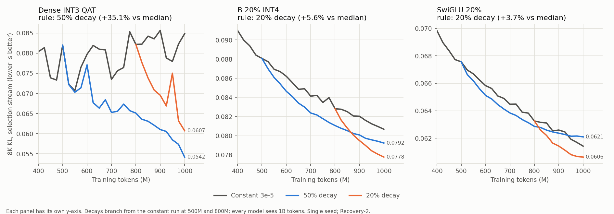
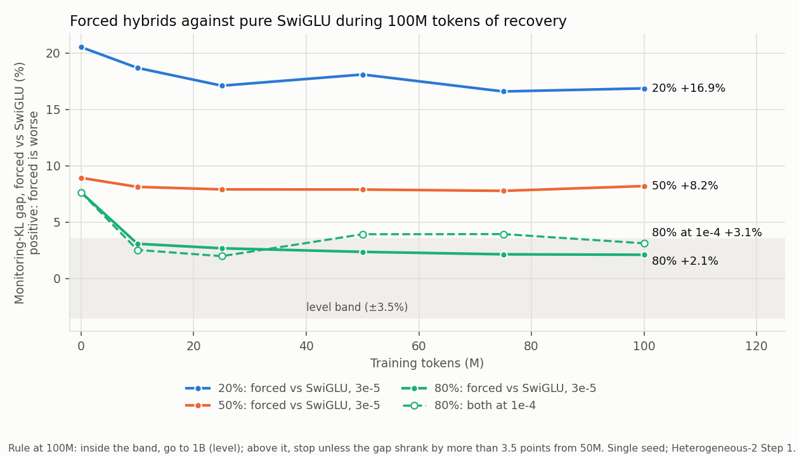

# Thesis results, snapshot 2026-11-13

This snapshot follows the [2026-11-01 snapshot](2026-11-01-results.md), presented on
2026-11-06. It adds the work agreed there: the recovery schedule screens
([Recovery-1](../experiments/model/recovery/recovery-1.md) at 100M tokens,
[Recovery-2](../experiments/model/recovery/recovery-2.md) at 1B) and the first trained
heterogeneous models ([Heterogeneous-2](../experiments/model/heterogenous/heterogeneous-2.md)
Step 1). The model, the [core-eval](../methodology/core-eval.md) metrics, and the single-seed
rule are unchanged. Every value comes from the artifacts via the
[presentation notebook](../../notebooks/presentations/results-2026-11-13.ipynb).

The recovery screens score the 8K KL on SwiGLU-8's selection stream and keep no model, so their
decay models have no task accuracy or perplexity, and the size frontier of 2026-11-01 is
unchanged.

## Headline

| Question | Answer so far |
| --- | --- |
| Does a learning-rate decay at the end of recovery help? | At 1B, yes for dense INT3 QAT (50% decay, +35%) and B 20% INT4 (20% decay, +6%); not measurably for SwiGLU alone (section 1) |
| Which ~51% model wins at 1B, each with its best schedule? | Dense INT3 QAT, 30% lower KL than B 20% INT4 (0.054 against 0.078) and slightly smaller. Under the constant rate their order depended on the stream (section 1) |
| Do hybrids beat pure SwiGLU? | No. The allocator picks no non-SwiGLU block at any target (Heterogeneous-1, discussed on 2026-11-06), and hybrids forced in stay worse after 100M tokens at 20% and 50% (+17%, +8%). Only at 80% are they level (+2.1%), which goes to 1B by the rule (section 2) |
| Is the constant 3e-5 rate holding SwiGLU back? | At 80%, a rate of 1e-4 improves SwiGLU itself by 9.8% at 100M; untested elsewhere (section 2) |

## 1. Recovery schedule

| Family | 100M (Recovery-1) | 1B: 20% / 50% decay | 1B decision | 3B schedule (decision log, 2026-11-11) |
| --- | --- | --- | --- | --- |
| Dense INT3 QAT | 20% decay (+5.8%) | +27.2% / **+35.1%** | 50% decay | Constant to 1.5B, then decay over the last 1.5B |
| B 20% INT4 | constant (best +0.6%) | **+5.6%** / +3.9% | 20% decay | Constant to 2.4B, then decay over the last 600M |
| SwiGLU 20% | constant (0.0%) | **+3.7%** / +1.3% | 20% decay, marginal | As B, if a SwiGLU-alone 3B run is planned |

Gain = 1 − decay / reference: at 1B the reference is the median of the constant run at 750M to
1B, at 100M its lowest value at 75-100M. The bar is 3.5%. Each decay falls 1-sqrt to 0 from a
3e-5 peak, without warmup.

- **Dense INT3 never settles at a constant rate.** Its constant run swings 12% between rows, and
  the longer the decay, the better it gets.
- **SwiGLU's decay is within noise:** it clears the bar by 0.16 points but gains only 1.3% over
  its own 1B row. Two runs of this model already differ by 1.42%.
- **Near 51% saving,** dense INT3 QAT (51.6%) reaches 0.0542 and B 20% INT4 (50.9%) 0.0778. At
  the constant rate this stream put B 5% ahead (0.0807 against 0.0848), while the final 8K
  stream of 2026-11-01 put INT3 8% ahead.

## 2. Heterogeneous replacement

Heterogeneous-1, discussed on 2026-11-06 (first written record): the allocator picks no
non-SwiGLU block at any target. Heterogeneous-2 therefore forces non-SwiGLU blocks into the eight layers predicted to
suffer least, and trains the result for 100M tokens with SwiGLU-8's recipe.

| Target | Forced blocks | Gap at 100M, monitoring KL (8K KL) | Outcome |
| --- | --- | ---: | --- |
| 20% | 8 linear + SwiGLU | +16.9% (+15.4%) | Stop |
| 50% | 7 linear + SwiGLU, 1 plain MLP | +8.2% (+7.2%) | Stop |
| 80% | 8 plain MLP | +2.1% (+2.3%) | Level: go to 1B |

- **Proposed conclusion: with the operators tested, heterogeneous replacement does not beat
  SwiGLU on dense SmolLM2.** At 20% and 50% the gap hardly moves after 10M tokens; at 80% it is a
  tie, also at 1e-4 (+3.1%). Fairly tested: zero, mean, linear, plain MLP, linear + SwiGLU.
  Linear + plain MLP mostly failed to train in its block fits, so it is not fairly tested; where it
  trained (two layers, 25%) it ranked last.
- **The comparison favours SwiGLU's teacher start:** it begins from the teacher's best neurons,
  while plain MLP starts random. It answers the practical question, not which function type is
  better in itself. Other function classes (for example RBF or KAN-style blocks) and other models
  (for example MoE) are untested.
- **SwiGLU 80% at 1e-4 (+9.8%) is a better SwiGLU-alone result than any hybrid,** a limit of the
  3e-5 recipe, untested at other targets and at 1B.

### 2.1 The linear + plain MLP hybrid did not train

Found while reviewing Heterogeneous-1's fits; no new run. A fit "stalled" when training never beat
its starting weights, so the start was kept. The frozen rows train only the MLP part.

| Block (recipe-selection fits) | Layer 3 | Layer 11 | Layer 19 |
| --- | ---: | ---: | ---: |
| Linear + plain MLP | 43/78 stalled | 36/78 | 0/78 |
| Same, linear part frozen | 6/6 | 3/6 | 0/6 |
| Linear + SwiGLU | 0/78 | 0/78 | 0/78 |
| Plain MLP alone | 0/78 | 0/78 | 0/78 |

- **Not a bug, a start-up problem.** The hybrid starts as a random MLP plus a linear fit that
  cancels the MLP's random output. Training the MLP part breaks that balance, so the error rises
  first and the fit gives up. Freezing the linear part does not help at layer 3, and the same MLP
  trains fine alone. This is the best reading, not proven.
- **So its results are inconclusive, not negative.** It even loses to a narrower plain MLP in 14-21
  of 22 layers, which a hybrid that contains that MLP cannot do when it trains. Whether a linear
  part adds anything next to an MLP is therefore unanswered; the evidence that it does not pay
  comes from linear + SwiGLU.
- **A cheap fix answers it:** train the plain MLP first, then fit the linear part to what it still
  misses. The hybrid can then only match or beat the MLP alone, and the gap is the linear part's
  value (block-level, a few GPU-hours, estimate; not built).

## 3. Questions for the meeting

1. **Is the 3B comparison still needed?** It was meant to test whether B 20% INT4 catches dense
   INT3 QAT with more training. At 1B and each family's best schedule, dense INT3 leads by 30%.
   Both runs at 3B would cost about 75-80 GPU-hours (estimate from Recovery-2's measured speeds).
   The alternative is to report quantization alone as the winner near 51% from the 1B results.
2. **Close heterogeneous replacement for dense SmolLM2?** The proposal is not to run 80% at 1B,
   although the rule of 2026-11-06 would, because 80% is level. A tie cannot give a better
   SwiGLU-alone point, the gap shrank only 0.3 points from 50M to 100M, and the run needs save
   and load for non-SwiGLU blocks plus 10-24 GPU-hours. The 80% tie would be reported as
   unresolved at 1B. Operators that reuse the teacher's weights (MoE, MoNE) would be the follow-up.
   Optional before writing it up: the MLP-first retry of section 2.1, so the linear + plain MLP
   arm is answered rather than inconclusive.
3. **Peak learning rate:** screen 1e-4 for SwiGLU alone, and possibly the other families, before
   more long runs? Every recovery so far used 3e-5.
4. **Framing,** from a whole-project review on 2026-11-12 and not yet decided: an evaluation
   thesis with three results. Replacement behaves like width pruning; local fitting is a head
   start that fades with training; precision saves bytes, structure saves compute, and the two
   combine.
5. **Weekly Friday meetings,** to confirm.

## Cost to produce

| Experiment | Training tokens | GPU-hours |
| --- | ---: | ---: |
| Recovery-1, 3 families | 3 × 180M | 6.5 |
| Heterogeneous-2 Step 1, 6 runs | 6 × 100M | 9.9 |
| Recovery-2, 3 families | 3 × 1.7B | 61.2 |
| **Total** | | **77.6** |

Workflow timing on one H200 per task, from the run records; a lower bound, because the scheduler
records had expired.

## Open gaps

| Gap | Status |
| --- | --- |
| Decay models: accuracy and perplexity | Not measured; the recovery screens keep no model. The 3B or rerun models would be evaluated in full |
| Schedule transfer from 1B to 3B | Assumed and reported as a limit (decision log, 2026-11-08) |
| Peak learning rate | Untested; SwiGLU 80% at 1e-4 suggests that 3e-5 is low at high removal |
| Heterogeneous Step 2 (80% at 1B) | Proposed to close instead (question 2); not built, it would need save and load for non-SwiGLU blocks |
| INT3 QAT 1B validation spikes | Recovery-2's constant dense run shows the same instability (12% swings) but not the 100M spike; the 50% decay largely removes the swings. Cause not isolated |
| Order B at 1B, final validation row | Unchanged since 2026-11-01 |
| Order C, GPTQ for INT3 | Unchanged since 2026-11-01 |

Closed since 2026-11-01:
- The recovery schedule of each family is chosen for 3B (section 1).
- Heterogeneous replacement has its first trained models (section 2).
